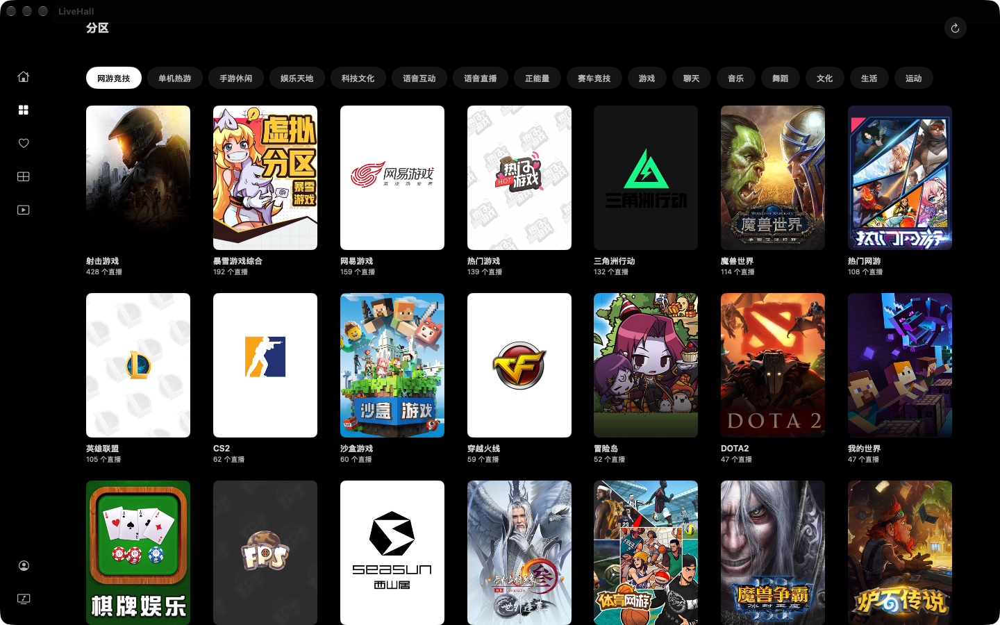
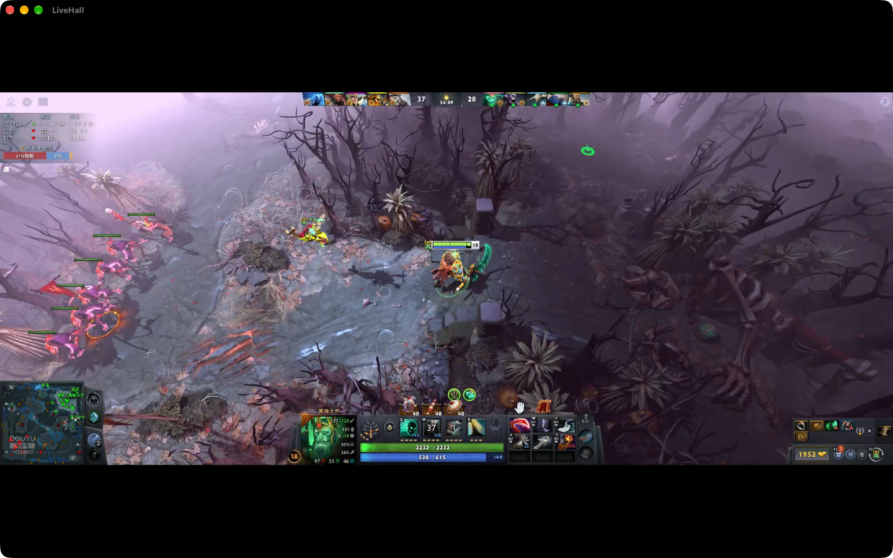

# LiveHall

macOS 原生直播客户端，Swift 6 + SwiftUI，只做 Mac（Apple 芯片，macOS 26 起）。斗鱼与抖音的直播间合并展示，没有后端，关注、看过、偏好都存在本机。

与斗鱼、抖音及其运营方没有任何关联，这是一个独立的个人项目。

> 斗鱼在 Mac 上实在太难用，所以写了这个项目，仅供学习交流。如有侵权，请在本仓库提交 Issue 联系我，我将删除此仓库。

## 功能

- 首页 Billboard、分区、我的关注、搜索，悬停预览，点击即播
- 自写 FLV 解复用，`AVSampleBufferDisplayLayer` 硬解上屏，自动追直播点、断流重连、换线
- 弹幕（Core Animation 图层池）、小窗口、画中画、多看（最多四路）
- 抖音短视频推荐流

## 截图





## 编译

需要 Xcode，Apple 芯片的 Mac。工程用 ad-hoc 签名（Sign to Run Locally），不需要 Apple 开发者账号。

```bash
xcodebuild -project LiveHall.xcodeproj -scheme LiveHall -configuration Release -derivedDataPath build build
open build/Build/Products/Release/LiveHall.app
```

## 抖音签名脚本

抖音的接口与弹幕签名依赖两段脚本，不在本仓库里。自备后放到 `LiveHall/Resources/Douyin/`：

| 文件 | 入口函数 |
|---|---|
| `a_bogus.js` | `getABogus(params, userAgent)`，返回 `a_bogus` |
| `webmssdk.js` | `getMSSDKSignature(msStub, userAgent)`，返回弹幕连接的 `signature` |

不放脚本也能编译、运行：斗鱼不受影响，抖音相关内容不可用。

## 许可证

[MIT](LICENSE)
